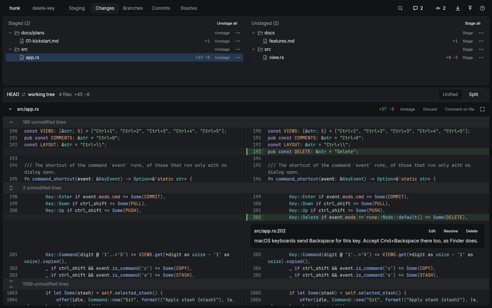
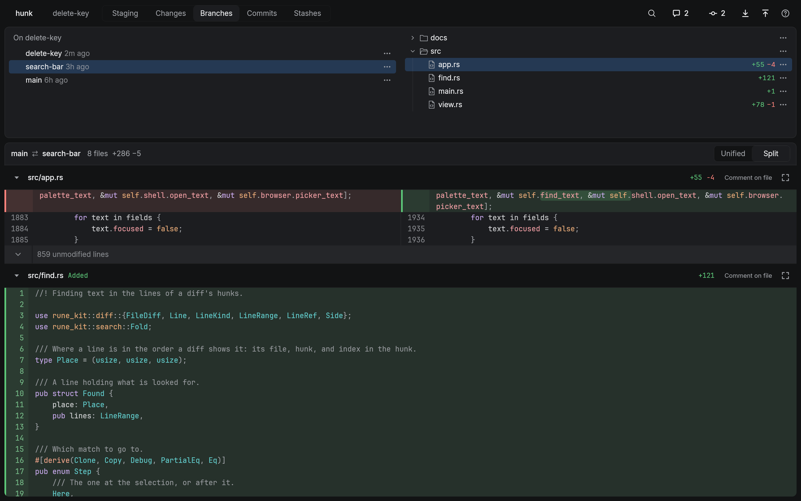

# hunk

hunk is an integrated review environment (IRE™): a desktop app for reviewing Git changes, whether you made them or a coding agent did. Read the diff, leave comments where something needs another pass, hand them to your agent, and commit what's good.

It runs on Linux and macOS, and it's built with [Rune](https://github.com/anomalyco/rune).





## Features

- **A view for every kind of review**, from checking what an agent just changed to looking over a whole branch before you merge it.
- **Comments for your agent, or for a pull request.** Comment on the code as you read, then copy all of them as one prompt, or send them to the branch's pull request as a review. They stay with the code even as it changes.
- **Git without leaving the review.** Stage, commit, stash, switch branches, merge, pull and push right where you're reading.
- **GitHub integration.** See a branch's pull request, open it, create a new one, or review it: request changes, comment or approve, in one click.
- **A file browser** for when the diff isn't enough: open any file whole, with its changes marked.
- **Keyboard friendly.** A command palette has everything, and what you do often has a key.
- **Always current.** It refreshes as you or your agent work, without losing your place.

## Install

You'll need [Rust](https://rustup.rs) and Git, and on Linux a GPU with Vulkan support.

```bash
git clone https://github.com/volfpeter/hunk.git
cd hunk
./install.sh
```

This puts the `hunk` command in `~/.local/bin` (make sure it's on your `PATH`) and adds the app to your launcher. To update, run `git pull` and `./install.sh` again. To remove it, run `./install.sh --uninstall`.

## Use

```bash
hunk .                # review the repository you're in
hunk path/to/repo     # or another one
hunk                  # or the last one you had open
```

Press **Ctrl+K** to see everything you can do, and **Ctrl+H** for the keyboard shortcuts. For the rest, see [how to use hunk](docs/how-to-use.md).
